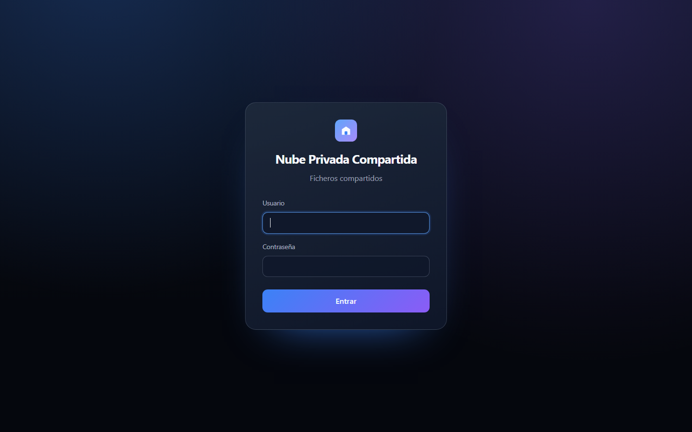

<p align="center">
  
</p>

<h1 align="center">Nube Privada Compartida</h1>

<p align="center">
  Tu nube privada para almacenar y compartir archivos en casa.
</p>

<p align="center">
  
  
  
  
  
  
</p>

<p align="center">
  <a href="https://github.com/adrianllorian/NubePrivadaCompartida/releases/latest/download/NubePrivadaCompartida.jar">
    
  </a>
</p>

<p align="center">
  <strong>Java 17+ · 60 MB · Windows / Linux / macOS</strong>
</p>

---

## Vista previa

<p align="center">
  
</p>

## Características

- Subida de archivos **por trozos y con reanudación**.
- Carpetas, búsqueda y compartición mediante enlaces.
- Previsualización de imágenes, vídeo y PDF.
- Actividad de usuarios y administración de cuentas.
- Autenticación con sesiones, cookies `HttpOnly` y contraseñas BCrypt.
- Backend Spring Boot + SQLite y frontend Angular servido desde el mismo JAR.
- Interfaz integrada, sin necesidad de instalar un servidor web aparte.

## Descarga

Descarga siempre la última versión desde este enlace fijo:

**[Nube Privada Compartida (última versión)](https://github.com/adrianllorian/NubePrivadaCompartida/releases/latest/download/NubePrivadaCompartida.jar)**

- Archivo: `NubePrivadaCompartida.jar`
- Tamaño: 60,2 MB
- Requisito: **Java 17 o superior**
- Plataforma: Windows, Linux y macOS

### Verificar la descarga

SHA-256 del JAR:

```text
2B65C8DD648F0BF3E6299B3DB20E62268C23BEAFC2C832FC952EDC619878C49A
```

Para comprobarlo en PowerShell:

```powershell
Get-FileHash ".\NubePrivadaCompartida.jar" -Algorithm SHA256
```

## Ejecutar

1. Descarga `NubePrivadaCompartida.jar` y colócalo en una carpeta donde puedas escribir.
2. Arranca:

```powershell
java -jar NubePrivadaCompartida.jar
```

3. Abre en el navegador:

```text
http://localhost:8090
```

Para detener el servidor, pulsa `Ctrl + C` en la terminal.

### Primer arranque

Si la base de datos no tiene ningún administrador, la aplicación muestra una
pantalla de **Configuración inicial** para crear la cuenta de administrador.
La contraseña se guarda cifrada con BCrypt; no hay credenciales en el código.

Después, el administrador puede crear el resto de usuarios desde la pestaña
**Usuarios**.

### Ubicación de los datos

Por defecto, todo se guarda en una carpeta `data` **junto al JAR**. Si prefieres
otra ubicación, define `CLOUD_HOME`:

```powershell
$env:CLOUD_HOME = "D:\MisDatos\NubePrivada"
java -jar NubePrivadaCompartida.jar
```

En Linux / macOS:

```bash
export CLOUD_HOME=/home/usuario/NubePrivada
java -jar NubePrivadaCompartida.jar
```

La carpeta se crea automáticamente en el primer arranque.

## Uso

1. Entra como administrador y crea los usuarios en **Usuarios**.
2. Sube archivos y organiza el contenido en carpetas.
3. Usa la búsqueda o los enlaces de compartición para encontrar y enviar archivos.
4. Previsualiza imágenes, vídeo y PDF sin descargarlos.

## Datos y copias de seguridad

Por defecto se guardan en la carpeta `data` **junto al JAR**:

```text
data/
├── nube-privada.db   # base de datos SQLite
├── uploads/          # archivos subidos
├── files/            # estructura de carpetas
├── thumbs/           # miniaturas
└── tmp/              # temporales de subida
```

- Para hacer una copia de seguridad, detén la aplicación y copia la carpeta `data` completa.
- Para restaurarla, deja la carpeta `data` junto al JAR y arranca de nuevo.
- Si mueves el JAR, mueve también `data`. Si mueves solo el JAR, la aplicación creará una nube nueva y vacía junto a la nueva ubicación. Los datos antiguos no se borran: siguen en la carpeta anterior.
- Si vienes de la versión anterior, la aplicación renombra automáticamente `cloudshare.db` a `nube-privada.db` para conservar tus datos.
- No subas la carpeta `data` a GitHub.

## Sesión

La sesión dura **30 días** por defecto y la cookie también es persistente: si
cierras y vuelves a abrir el navegador, la sesión se mantiene hasta que caduque
o pulses **Salir**. Puedes cambiar el tiempo con la variable `SESSION_TIMEOUT`:

```powershell
$env:SESSION_TIMEOUT = "2h"
java -jar NubePrivadaCompartida.jar
```

También se puede pasar como argumento (hay que cambiar las dos propiedades):

```powershell
java -jar NubePrivadaCompartida.jar --server.servlet.session.timeout=8h --server.servlet.session.cookie.max-age=8h
```

Valores habituales: `30m`, `2h`, `8h`, `1d`, `30d`.

## Compilar desde el código

Requisitos:

- Java 17 o superior
- Maven 3.9 o superior
- Node.js 20 o superior y npm

La forma más rápida es usar el script de compilación:

```powershell
.\build.ps1
```

En Linux / macOS:

```bash
./build.sh
```

El JAR se genera en `backend/target/NubePrivadaCompartida.jar` y se ejecuta igual que el descargado:

```powershell
java -jar backend/target/NubePrivadaCompartida.jar
```

### Desarrollo del frontend

```powershell
cd ui
npm install
npm run build
```

El resultado queda en `ui/dist/ui/browser`. El script de compilación lo copia
automáticamente a `backend/src/main/resources/static`.

### Publicar una release

1. Compila el JAR y pruébalo.
2. En GitHub, entra en **Releases → Draft a new release**.
3. Crea el tag de la versión y adjunta el JAR.
4. Publica la release.

## Estructura del proyecto

```text
NubePrivadaCompartida/
├── backend/                    # Spring Boot + SQLite
│   ├── src/main/java/          # API, seguridad, almacenamiento
│   ├── src/main/resources/
│   └── pom.xml
├── ui/                         # Angular 20
│   ├── src/app/
│   └── package.json
├── build.ps1                   # Compilación en Windows
├── build.sh                    # Compilación en Linux/macOS
├── docs/screenshot.png
├── LICENSE
└── README.md
```

## Tecnologías

| Capa | Tecnología |
| --- | --- |
| Lenguaje | Java 17 |
| Framework | Spring Boot 3.3.5 |
| Frontend | Angular 20 |
| Base de datos | SQLite |
| Autenticación | Sesiones + BCrypt |
| Empaquetado | JAR ejecutable con frontend incluido |

## Seguridad

- Contraseñas con BCrypt, nunca en texto plano.
- Cookies de sesión `HttpOnly` y `SameSite=Lax`.
- No se versionan bases de datos, subidas, logs ni `.env`.
- Para exponerlo fuera de la red local, usa un proxy inverso con HTTPS.

## Licencia

Distribuido bajo **MIT License**. Consulta [LICENSE](LICENSE).

---

<p align="center">
  Copyright © 2026 Adrian Llorian
</p>
